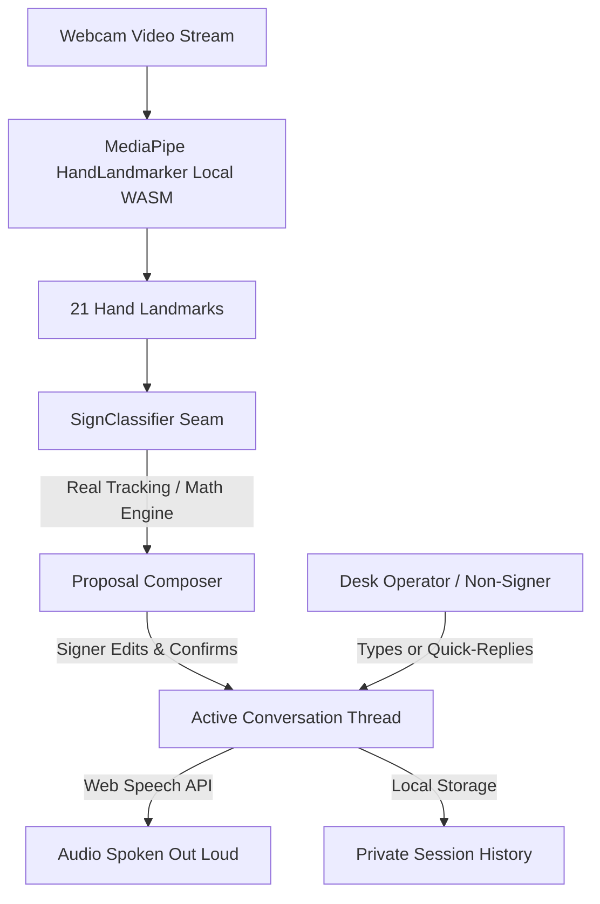

# SignBridge: System Architecture

## Overview
SignBridge is a high-accessibility, privacy-first Indian Sign Language (ISL) communication interface designed for shared screens at campus reception, information desks, and healthcare counters.



## Key Architectural Principles

1. **Local-Only Processing:** Video frames are analyzed in-memory on the client via WebAssembly. No frames, snapshots, or biometric data are transmitted over the network or saved to disk.
2. **Explicit User Agency:** The system does not auto-send recognized gestures into the chat. Gestures appear in an editable proposal box where the signer retains full control to confirm, edit, or clear.
3. **Strict Warm Theme (Zero-Blue Mandate):** The entire interface is rendered using custom warm design tokens (`--ivory`, `--cream`, `--sand`, `--terracotta`, `--burnt-orange`, `--chocolate`, `--brown`, `--muted-text`, `--border`, `--olive`, `--brick`). Cool greys and blues are strictly blocked by build-time audits.
4. **Resilient Multi-Device Support:** Full graceful degradation when cameras are unavailable or permissions are denied. The two-way text conversation remains 100% operational.

## Directory Structure
```
src/
  app/            App shell, tab navigation, global keyboard shortcuts
  components/ui/  Warm-themed accessible buttons, modals, toasts, toggles, badges
  features/
    camera/       useCamera hook (lifecycle, stream termination, device selector)
    tracking/     useHandTracker hook (MediaPipe loop, RAF throttling, FPS measurement)
    recognition/  Classifier interface, ISL geometric classifier, temporal smoothing
    conversation/ Thread store, MessageList, Composer, QuickReplies, LargeDisplay
    history/      IndexedDB/localStorage persistence, export/import, search
    settings/     Config store, theme switcher, TTS voices, accessibility options
    vocabulary/   ISLRTC-referenced signs database, categories, search
  styles/
    tokens.css    Single source of truth for color palette, spacing, typography
    base.css      Warm focus states, selection styles, reduced-motion queries
```
